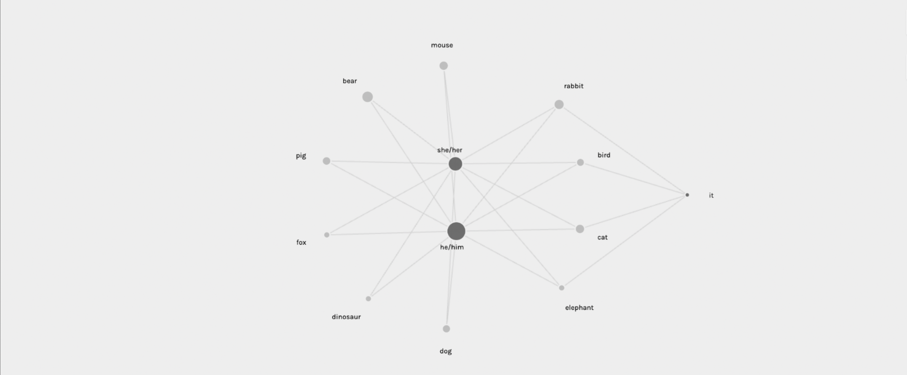

[Home](./)

# Results

## Introduction to Our Findings

Our project examines how gender is represented through animal characters in children's books published across different historical periods, ranging from 1697 to 2023. Using a dataset of 841 animal-character records, we explore whether certain animal species are more frequently portrayed as male, female, or gender-neutral.

Through visualizations created using Tableau and Palladio, we investigate patterns in gender representation across animal species and examine the relationships between different animals and the pronouns used to describe them.

## Finding 1: Gender Representation by Species

This visualization examines how gender representation varies across the top ten most frequent animal species in our dataset.

*Figure 1: Gender Representation of Animal Characters by Species in Children's Books. Male characters dominate most species, particularly foxes (89.47%), dogs (80.49%), and elephants (78.95%). Birds are the only species where female characters outnumber male characters, at 51.35% compared to 43.24%. These findings suggest that gender representation varies by species, with male characters generally appearing more frequently than female characters.*

## Finding 2: Relationships Between Animal Species and Gender

This network visualization examines how different animal species are connected to gendered and gender-neutral pronouns in children's books. Unlike the first visualization, which compares percentages, this graph highlights the relationships between animal species and the pronouns used to describe them.

*Figure 2: Relationships Between Animal Species and Gender in Children's Books. This network graph illustrates the connections between the ten most frequently represented animal species and three pronoun categories: "he/him," "she/her," and "it." Most species are connected to both male and female pronouns, while fewer are connected to the gender-neutral pronoun "it." The visualization highlights how gender-neutral representation is less widespread across species, reinforcing the broader pattern of gendered representation observed in Figure 1.*

