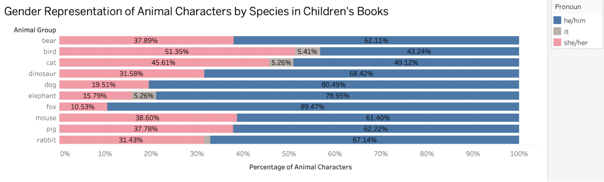

[Home](./)

# Results

## Finding 1: Gender Representation by Species

This visualization examines how gender representation varies across the top ten most frequent animal species in our dataset.

*Figure 1: Gender Representation of Animal Characters by Species in Children's Books. Male characters dominate most species, particularly foxes (89.47%), dogs (80.49%), and elephants (78.95%). Birds are the only species where female characters outnumber male characters, at 51.35% compared to 43.24%. These findings suggest that gender representation varies by species, with male characters generally appearing more frequently than female characters.*

## Finding 2

| Group | Measurement |
|-------|-------------|
| A     | 12          |
| B     | 18          |
